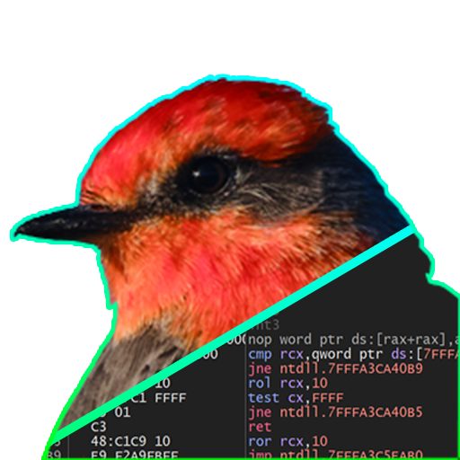

<div align="center">


# RedBird.NET

RedBird is a ([mostly](src/RedBird.Core/native/linux-x64/README.md)) managed native-hooking toolkit for .NET. 
It offers X64 and X86 detour engines, transactional pattern-based hooks, executable-memory helpers, modular backends, and calling convention intermediary stubs.

<br/>

| CI/CD | Release | Downloads | License |
|:---:|:---:|:---:|:---:|
| [](https://gitlab.com/Rawra/redbird/-/pipelines) | [](https://gitlab.com/Rawra/redbird/-/releases) | [](https://www.nuget.org/packages/RedBird/) | [](LICENSE.txt) |

  [](https://github.com/icedland/iced)  

</div>

## Highlights

- Managed native X64 and X86 detour backends with relocated-original trampolines.
- Safe executable-code patching on Windows X64/X86 and Linux X64: peer threads are parked while instruction pointers inside a replaced prologue are moved to their trampoline equivalents.
- Hook chaining with safe reverse-order unhooking.
- Pattern (wildcard AOB), relative-call destination, address, RVA, and export targets with transactional commit and rollback policies.
- Context hooks, inline hooks, function clones, stateful assembly patches, and instruction walkers.
- Public runtime-assembled executable functions for X64 and X86.
- Supports X86 cdecl, stdcall, fastcall, thiscall, GCC, Pascal, and custom register/stack layouts.
- Supports X64 managed ABI and Microsoft `__vectorcall` intermediary stubs in both directions, including scalar, SIMD, HVA, and supported aggregate-return layouts on Windows and System V Linux.
- Multi-targeted packages for `net10.0` and .NET Framework 4.8.

## Packages

```shell
dotnet add package RedBird
dotnet add package RedBird.Extensions.CallingConventions
```

The `RedBird` meta-package includes the main X64/X86 libraries and native backends. 
Every package can also be referenced separately:

| Package | Purpose |
|---|---|
| `RedBird` | Meta-package for the main X64/X86 libraries and native backends |
| `RedBird.Abstractions` | Backend-agnostic hook, transaction, and ABI contracts |
| `RedBird.Core` | Executable memory, scanners, platform helpers, and the Linux X64 patch companion |
| `RedBird.X64` | X64 scanners, transactions, inline/context hooks, and executable functions |
| `RedBird.X86` | X86 hooks and executable functions |
| `RedBird.Backends.NativeX64` | Managed X64 function-detour engine |
| `RedBird.Backends.NativeX86` | Managed X86 function-detour engine |
| `RedBird.Backends.PolyHook2` | Optional PolyHook2 backend with safe logical chaining |
| `RedBird.Backends.MinHook` | Optional MinHook.NET backend |
| `RedBird.Extensions.CallingConventions` | X86 convention and X64 vectorcall adapters |

## Example: assemble and detour a real function

This self-contained example creates native code, calls it, hooks it, calls the relocated original, and restores it. The complete runnable version lives in [samples/RedBird.Examples](samples/RedBird.Examples/Program.cs).

```csharp
using System;
using System.Runtime.InteropServices;
using Iced.Intel;
using RedBird.Abstractions.Hooks;
using RedBird.Backends.NativeX64;
using RedBird.X64.Assembly;
using static Iced.Intel.AssemblerRegisters;

internal static class Program
{
    [UnmanagedFunctionPointer(CallingConvention.Cdecl)]
    private delegate int BinaryInt(int left, int right);

    private static void Main()
    {
        using var target = ExecutableFunction.Create(assembler =>
        {
            if (OperatingSystem.IsWindows())
            {
                assembler.mov(eax, ecx);
                assembler.add(eax, edx);
            }
            else
            {
                assembler.mov(eax, edi);
                assembler.add(eax, esi);
            }
            for (var i = 0; i < 20; i++) assembler.nop();
            assembler.ret();
        });

        var call = target.GetDelegate<BinaryInt>();
        IDetour<BinaryInt>? hook = null;
        hook = NativeDetourBackend.Instance.CreateDetour(new DetourRequest<BinaryInt>
        {
            Name = "multiply-add-result",
            TargetAddress = target.Address,
            Callback = (a, b) => hook!.Original(a, b) * 10,
        });

        using (hook)
        {
            Console.WriteLine(call(3, 4)); // 7
            hook.Enable();
            Console.WriteLine(call(3, 4)); // 70
        }
        Console.WriteLine(call(3, 4)); // 7
    }
}
```

## Example: adapt an X86 fastcall target

The delegate describes the managed cdecl view. The intermediary factory generates both directions:
native fastcall -> managed callback and managed `Original` call -> native fastcall.

```csharp
using System.Runtime.InteropServices;
using RedBird.Abstractions.CallingConventions;
using RedBird.Abstractions.Hooks;
using RedBird.Backends.NativeX86;
using RedBird.Extensions.CallingConventions.NativeX86;

[UnmanagedFunctionPointer(CallingConvention.Cdecl)]
delegate int NativeFunction(int first, int second, int third);

var request = new DetourRequest<NativeFunction>
{
    Name = "fastcall-target",
    TargetAddress = targetAddress,
    Callback = callback,
    IntermediaryFactory =
        new X86CallingConventionIntermediaryFactory<NativeFunction>(X86CallingConvention.Fastcall),
};

using var hook = X86DetourBackend.Instance.CreateDetour(request);
hook.Enable();
```

Custom X86 layouts use `[X86CallingConvention]`, `[X86RegisterArgument]`, explicit stack cleanup,
argument order, and optional custom return registers.

## Example: bridge the managed X64 ABI and vectorcall

```csharp
using System.Runtime.InteropServices;
using System.Runtime.Intrinsics;
using RedBird.Abstractions.Hooks;
using RedBird.Extensions.CallingConventions.NativeX64;

[UnmanagedFunctionPointer(CallingConvention.Cdecl)]
delegate float VectorOperation(float scale, [VectorcallArgument(16)] Vector128<float> value);

var request = new DetourRequest<VectorOperation>
{
    Name = "vectorcall-target",
    TargetAddress = targetAddress,
    Callback = callback,
    IntermediaryFactory = new X64VectorcallIntermediaryFactory<VectorOperation>(),
};
```

The factory wraps both the callback entry and `Original` trampoline path. See the
[calling-convention guide](docs/articles/calling-conventions.md) for HVA annotations, supported
returns, and ABI limitations.

## Transaction and scanner conveniences

Transactions return a fresh handle when a hook does not need a predeclared field. 
This works for detours and context hooks; the transaction retains ownership, so the return value may be ignored:

```csharp
transaction.AddContextHook(
    HookTarget.FromPattern("48 89 5C 24 ?? 57", offset: 6),
    OnContext);
```

When only a call site has a stable signature, resolve the direct relative `CALL` destination explicitly.
This hooks the called function, while leaving the call instruction itself intact:

```csharp
transaction.AddDetour(
    createTribeHook,
    HookTarget.FromRelativeCall("E8 ?? ?? ?? ?? 48 63 F8 89 7C 24 ?? 85 C0"),
    OnCreateTribe);
```

Use `callOffset` when the signature begins before the call. Indirect calls are rejected.
`FromPattern` continues to mean that the matched address itself is the hook target.

When a callback needs `Original`, initialize its persistent handle before registration. Export
targets do not change that requirement:

```csharp
private readonly DetourHandle<LoadMapDelegate> loadMapHook = new();

transaction.AddDetour(
    loadMapHook,
    HookTarget.FromExport("DLL_LoadMapToPlay", moduleHandle),
    OnLoadMap);
```

Passing an uninitialized (`null`) handle fails during registration, before the export is resolved.
If no persistent handle is needed, omit the first argument and keep the handle returned by the handle-less overload instead.

`DataScanner.CurrentAddress` reports the absolute virtual address. 
`CurrentOffset` reports the signed byte offset from the associated `ScanRegion.BaseAddress`, which is useful when recording an RVA. 
Check `Found` first because both a failed scan and a successful match at the region base report an offset of zero.

### Persistent AOB cache

Transactions can persist pattern matches as region-relative virtual addresses and reuse them on the next run:

```csharp
using RedBird.Core.Memory.Scanners;

string cacheDirectory = "MyCacheDir";

var options = new HookTransactionOptions
{
    Backend = NativeDetourBackend.Instance,
    AobCache = new AobCacheOptions(Path.Combine(cacheDirectory, "game-module.aobcache.json")),
};

using var transaction = new HookTransaction(region, options: options);
```

The parent directory is created on the first write. The compact JSON file contains a format version,
the scan-region length, an XXH64 checksum, and an AOB-to-RVA map. 

On a checksum match, cached entries are also checked against the current bytes before use. 
A complete cache hit avoids the multi-pattern scan; partial hits scan only the missing patterns and then update the file. Missing patterns are cached too.

The same cache works with the x64 and x86 `DataScanner`. `Scan` reuses first-match RVAs, while
`ScanAll` persists complete multi-match RVA sets. When `ScanAll` reaches its result limit, that truncated
set is returned but is not reused later as a complete result. A scanner instance loads and checksums its
region only once, then shares that state across its fluent scan calls. Core callers can also pass a
`ScanRegion` and `AobCacheOptions` to the cached `MultiPatternScanner.FindFirst`/`FindAll` overloads.

Use one cache file per module or scan region. A changed checksum, malformed file, unsupported format,
or invalid RVA causes a safe rescan. Cache I/O errors are logged and never fail the hook transaction.

`AobCacheOptions.Store` defaults to `JsonAobCacheStore.Instance`. Implement `IAobCacheStore` and set
that property when a binary format such as MessagePack or otherwise is preferable.

## X86 and X64 switch/FSM dispatches

`SwitchDispatchDecoder` resolves supported compiler jump tables back into selector values, handler addresses, shared/default blocks, and half-open linear boundaries. A case block can create an `InstructionWalker` that is automatically capped before the next distinct handler:

```csharp
SwitchDispatch dispatch = SwitchDispatchDecoder.Decode(region, functionAddress);
SwitchCaseBlock state65 = dispatch.GetCase(0x65);
InstructionWalker walker = state65.CreateWalker(walkerConfig, logger);
```

The x64 implementation handles direct signed table-relative layouts commonly emitted by GCC and Clang, plus direct or byte-remapped unsigned image-relative layouts used by MSVC. 

The x86 package handles absolute pointer tables and statically based relative tables, with optional byte remapping.

See the [switch-dispatch guide](docs/articles/switch-dispatches.md) for supported shapes and boundary caveats.
## Platform support

| Feature | Windows X64 | Windows X86 | Linux X64 | Linux X86 |
|---|:---:|:---:|:---:|:---:|
| Native detours | ✓ | ✓ | ✓ | Build-supported |
| Safe peer-thread patching | ✓ | ✓ | ✓ | — |
| X86 convention adapters | — | ✓ | — | Build-supported |
| X64 vectorcall adapters | ✓ | — | ✓ | — |
| PolyHook2 backend | ✓ | Dependency-supported | ✓ | — |
| MinHook backend | ✓ | ✓ | — | — |

Build-supported means the code compiles for that combination but is not exercised by this
repository's CI runners.

### Safe patching on Linux X64

`NativeDetourBackend` protects enable and disable operations by default on Linux X64 when
`/proc/self/maps` is available. Its packaged, C-runtime-free native companion (`libredbird_thread_patch.so`) selects an unused real-time signal, parks peer threads on futexes, relocates a saved instruction pointer when it falls inside the displaced prologue, applies the patch, restores page protections, and releases the threads.
The installed hook has no additional steady-state overhead from this mechanism.

The selected signal remains reserved for the process lifetime. 
If a peer thread blocks it, another component replaces its handler, thread enumeration fails, or all peers cannot be parked within five seconds, RedBird reports the failure without writing the patch. 
Set `SuspendThreadsDuringPatch` to `false` only when the host provides its own safe point or when you accept the patching race.

Unity Mono exposes `GC.TryStartNoGCRegion` on some profiles but throws `NotImplementedException` when it is called. 
RedBird detects that unsupported capability and uses its allocation-free critical patch path without no-GC mode. 
Runtimes which implement the API but cannot reserve the requested budget still fail before any peer thread is suspended.

See [Getting started: configure safe patching](docs/articles/getting-started.md#configure-safe-patching) and the [native companion notes](src/RedBird.Core/native/linux-x64/README.md).

## Build, test, docs, and package

On Linux x64, build the native thread-patching companion before creating distributable packages:

```shell
sh src/RedBird.Core/native/linux-x64/build.sh
```

Then build the managed projects, documentation, and packages:

```shell
dotnet restore RedBird.slnx
dotnet build RedBird.slnx -c Release --no-restore
dotnet tool restore
dotnet tool run docfx docs/docfx.json
dotnet pack RedBird.slnx -c Release --no-build -p:PackageVersion=0.1.0
```

Windows execution tests are architecture-specific:

```powershell
./scripts/ci/run-tests.ps1 -Architecture X64
./scripts/ci/run-tests.ps1 -Architecture X86
```

GitLab CI also rebuilds and smoke-tests the native Linux X64 companion, then runs the X64 test suite
on Linux. 
The companion's standalone build and test commands are documented in its
[native README](src/RedBird.Core/native/linux-x64/README.md).

## Documentation

- [Getting started](docs/articles/getting-started.md#getting-started)
- [Hooks and backends](docs/articles/hooks-and-backends.md)
- [Calling conventions](docs/articles/calling-conventions.md)
- [Executable functions](docs/articles/executable-functions.md)
- [API documentation](docs/api/index.md)

## License

RedBird.NET is licensed under [LGPL-3.0-or-later](LICENSE.txt).

## Credits and Thanks

- 0xd4d and the contributors of the amazing [Iced](https://github.com/icedland/iced) dis(assembler) engine! (Seriously its cracked)
- Stevemk14ebr and the contributors of the native [PolyHook2](https://github.com/stevemk14ebr/PolyHook_2_0) hooking library (Pretty much the best standalone hooking lib out there I reckon)
- -1212 (Safe Linux64 patching)
- Henry (The picture used for the logo - CC-BY-2.0, please see [ATTRIBUTIONS.md](docs/ATTRIBUTIONS.md#project-logo))

## Support the Project

This is a project maintained in my (@Rawra) free time.  
If you enjoy it and want to support its continued development, you can buy me a coffee:  

[](https://ko-fi.com/0xrawra)
